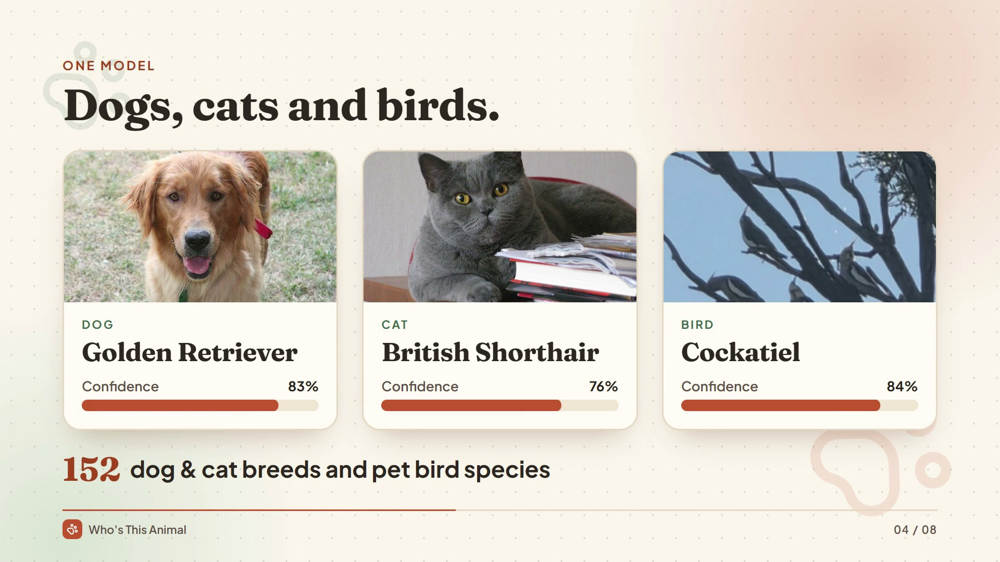
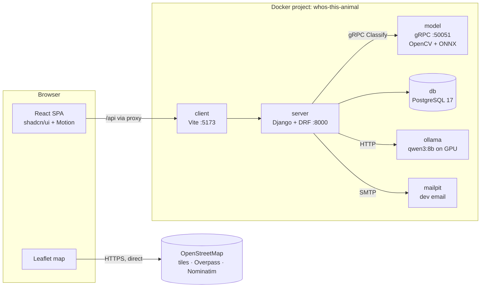
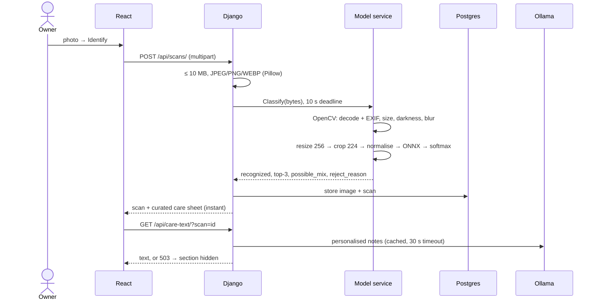

# Who's This Animal

A web app for first-time pet owners in Algeria. The owner takes a photo of their dog, cat or bird; the app identifies the **breed** (or the **species** for birds) and returns a care plan:

- how much to feed per day, in grams, for **this** pet's weight, age, neutered status and activity
- recommended food types and products
- a typical daily routine (meals, walks, play, grooming, rest)
- foods to avoid and common health issues
- pet shops and vets near the owner, on a map

Every scan is saved in the owner's history, and pets get their own profiles.

> School / portfolio project: it runs locally with Docker and is not deployed publicly. Care information is general guidance, **not veterinary advice**.

### ▶ 40-second showcase

[](docs/media/showcase.mp4)

**[Watch the showcase video (MP4, 40 s)](docs/media/showcase.mp4)**: sign-up and email verification, a live scan (golden retriever, 83%), three species from one model, the care sheet with grams per day, a personalised pet profile with LLM notes, nearby shops and vets, scan history, and the model's measured results. Every screen is the real app running in Docker.

<sub>Video made with [HyperFrames](https://hyperframes.heygen.com). Music: "Happy Beats / Business Moves vol. 1" by [ende.app](https://ende.app/en). Sound effects: Kenney.nl (CC0). Pet photos: held-out test images from Stanford Dogs, Oxford-IIIT Pet (CC BY-SA 4.0) and iNaturalist (cockatiel © Brodie Verrall, CC BY-NC). The food brands shown are the app's simulated demo data.</sub>

---

## Contents

1. [Features](#1-features)
2. [Architecture](#2-architecture)
3. [Tech stack and why](#3-tech-stack-and-why)
4. [The breed model: data, training, and why EfficientNetV2-S](#4-the-breed-model)
5. [How a scan works, end to end](#5-how-a-scan-works-end-to-end)
6. [Care data: curated numbers + formula + LLM](#6-care-data)
7. [Nearby shops and vets](#7-nearby-shops-and-vets)
8. [Getting started](#8-getting-started)
9. [Reproducing the model](#9-reproducing-the-model)
10. [Project layout](#10-project-layout)
11. [Configuration](#11-configuration)
12. [Tests](#12-tests)
13. [Status and known limitations](#13-status-and-known-limitations)

Full specs: [PRD](docs/PRD.md) (15 user scenarios) · [Implementation](docs/IMPLEMENTATION.md) · [Database schema](docs/DATABASE_SCHEMA.md) · [System design](docs/SYSTEM_DESIGN.md)

---

## 1. Features

| Area | What the owner can do |
|---|---|
| Landing page | Read what the app does, see a sample care sheet, sign up |
| Account | Sign up with email + password, verify the email, log in, reset a forgotten password |
| Scan | Take a photo (the rear camera opens on phones) or pick a file; get the breed, a confidence score and a care sheet |
| Bad photos | Blurry, dark, tiny or unreadable photos are rejected with a specific tip; unknown animals get "not recognized" |
| Look-alike breeds | When two breeds are close, the app says "possibly a mix of A and B" |
| Pets | Save a scan as a new pet (name, age, weight, sex, neutered, activity) or attach it to an existing pet; feeding is recalculated for that exact pet |
| History | Every scan, newest first, with the photo and result |
| Shops | Map + list of pet shops and vets near the owner (geolocation, or a typed city name) |

---

## 2. Architecture



Design decisions:

- **The model service is stateless and isolated.** It takes image bytes and returns labels. It has no database access and doesn't know about users, so it can be retrained and swapped without touching Django. The only contract is `proto/classifier.proto` plus the label list in `model/artifacts/meta.json`.
- **Thresholds live only in the model service.** The model service decides "recognized", "possible mix" and "rejected", and Django trusts that answer. Retraining therefore never needs a Django change.
- **The owner's location never reaches the backend.** The map calls OpenStreetMap directly from the browser.
- **One origin for the browser.** Vite proxies `/api` and `/media` to Django, so session cookies and CSRF work without CORS.

---

## 3. Tech stack and why

| Layer | Choice | Why |
|---|---|---|
| Frontend | React 19 + TypeScript + Vite + React Router | Fast SPA dev loop; typed API shapes |
| UI | shadcn/ui (Radix) + Tailwind CSS v4 | Accessible components that live in our code; design tokens in one CSS file |
| Animation | Motion (`motion/react`) | Page transitions, the scanning animation, result reveal, layout animations; respects "reduce motion" |
| Forms | Native HTML validation + the API's field errors | Forms are small; no form library needed |
| Backend | Django 5.2 + Django REST Framework | Auth, ORM, admin and migrations built in |
| Database | PostgreSQL 17 | Relational data + `JSONB` (routines, top-k), `int4range`, arrays |
| Model API | gRPC (`grpcio`) | Typed binary contract between Django and the model. FastAPI was considered and dropped: both would be ways to call the model, so one is enough. |
| Inference | ONNX Runtime on CPU | 21 ms per photo; no GPU needed to serve |
| Image processing | OpenCV | Decoding (with EXIF rotation), quality checks, resizing |
| Training | PyTorch 2.14 + timm, on an RTX 4060 (8 GB) | Pretrained backbones, bf16 mixed precision |
| LLM | Ollama, `qwen3:8b`, local GPU | Free, offline, no API key; writes friendly text and drafts seed data |
| Maps | Leaflet + OpenStreetMap (Overpass, Nominatim) | Free, no key or card. Google Maps needs a billing account; its free tier is 5,000 Nearby Search calls a month. |
| Dev email | Mailpit | Catches verification and reset emails, with a web inbox |
| Orchestration | docker-compose | One command starts all six services |

---

## 4. The breed model

### 4.1 What it recognises

**152 classes** in one classifier:

| Group | Classes | Source |
|---|---|---|
| Dogs | 125 breeds | [Stanford Dogs](http://vision.stanford.edu/aditya86/ImageNetDogs/) (120) + 5 extra breeds from Oxford-IIIT Pet |
| Cats | 12 breeds | [Oxford-IIIT Pet](https://www.robots.ox.ac.uk/~vgg/data/pets/) |
| Birds | 15 pet species | [iNaturalist](https://www.inaturalist.org/) (CC0 / CC-BY / CC-BY-NC photos; credits in `data/birds/attribution.csv`) |

The 15 birds: budgerigar, cockatiel, rosy-faced lovebird, Fischer's lovebird, domestic canary, zebra finch, Gouldian finch, society finch, grey parrot, monk parakeet, rose-ringed parakeet, sun conure, green-cheeked conure, blue-and-yellow macaw, domestic pigeon.

Data preparation details (`model/training/prepare_data.py`):

- Oxford dog breeds that duplicate a Stanford breed are **merged** (e.g. `japanese_chin` → `japanese_spaniel`, `wheaten_terrier` → `soft_coated_wheaten_terrier`), so one breed isn't two competing classes.
- Birds are kept as pet species, not breeds, because pet birds don't have breeds the way dogs do.
- iNaturalist mostly has wild birds. Domestic canaries, society finches and budgerigars look different from their wild relatives (colour mutations), so for those three species **captive** observations are fetched first.
- Every image is opened once to drop corrupt files.

**33,969 images**, split **70 / 15 / 15** stratified per class (fixed seed 42):

| Split | Images |
|---|---|
| Train | 23,783 |
| Validation | 5,093 |
| Test | 5,093 |

Birds have fewer images (~400 each) than dog breeds (~150–250 each, but 125 classes), and cats have 200 each. Training uses **class-balanced sampling**, so rare classes aren't drowned out.

### 4.2 Why one classifier, and why these two candidates

Options considered:

| Option | Verdict |
|---|---|
| **One fine-tuned classifier over all 152 classes** | ✅ Chosen. One model to train, serve and version; species are implied by the label. |
| Two-stage (species detector, then a breed model per species) | ❌ Three models to train and keep in sync, for no accuracy need at this scale. |
| CLIP / zero-shot | ❌ No training needed, but noticeably weaker at fine-grained breeds (e.g. Eskimo dog vs husky). |
| ViT-B/16 and larger | ❌ Slower on CPU and tight on an 8 GB GPU; the gain isn't worth it here. |
| A cloud vision API / LLM | ❌ Costs money per scan, needs internet, and gives the project no model of its own to evaluate. |

Two CNN-family backbones were shortlisted. Both are strong at fine-grained transfer, fit an 8 GB GPU comfortably, and run fast on CPU after ONNX export:

| Candidate | timm weights | Params | Why |
|---|---|---|---|
| **ConvNeXt-Tiny** | `convnext_tiny.fb_in22k_ft_in1k` | ~28 M | ImageNet-22k pretraining helps rare, fine-grained classes |
| **EfficientNetV2-S** | `tf_efficientnetv2_s.in21k_ft_in1k` | ~21 M | Similar accuracy class, smaller and faster on CPU |

### 4.3 Training recipe (identical for both)

| Setting | Value |
|---|---|
| Input | 224 × 224 |
| Augmentation | RandomResizedCrop (0.6–1.0), horizontal flip, ColorJitter 0.2, RandAugment (n=2, m=9) |
| Optimizer | AdamW, lr 1e-4 (backbone) / 3e-4 (new classifier head), weight decay 0.05 |
| Schedule | 1 warm-up epoch, then cosine decay; 15 epochs |
| Loss | Cross-entropy with label smoothing 0.1 |
| Precision | bf16 autocast on CUDA |
| Batch | 32 (peak GPU memory ~2.5 GB) |
| Sampling | Class-balanced (`WeightedRandomSampler`) |
| Checkpoint | Best validation top-1 |
| Normalisation | Each backbone's own mean/std (ImageNet stats for ConvNeXt, 0.5/0.5 for EfficientNetV2), saved in `meta.json` so serving uses the same values |

Training took about 85 s/epoch for ConvNeXt-Tiny and 100–130 s/epoch for EfficientNetV2-S, so about 25–30 minutes each. Full log: `model/runs/train_all.log`.

### 4.4 Results (held-out test split, 5,093 images)

| Metric | ConvNeXt-Tiny | **EfficientNetV2-S** |
|---|---|---|
| Top-1 accuracy | 89.0 % | **88.6 %** |
| Top-5 accuracy | 98.5 % | **98.3 %** |
| Macro-F1 | 0.878 | **0.875** |
| Best validation top-1 | 89.7 % | 88.7 % |
| CPU latency (ONNX, 1 image) | 28.9 ms | **21.0 ms** |
| ONNX file size | 106.6 MB | **77.6 MB** |
| ONNX vs PyTorch max difference | 3.1e-6 | 2.4e-6 |

Project targets: top-1 ≥ 85 %, top-5 ≥ 97 %. **Both models pass.**

### 4.5 Why EfficientNetV2-S was chosen

The decision rule was fixed **before** training (IMPLEMENTATION.md §6.4):

> Pick the higher macro-F1, unless the two are within 1 point; then pick the one with lower CPU latency.

- **Macro-F1 was used**, not plain accuracy, because it weights every breed equally, so a model can't look good by only nailing the common classes.
- Macro-F1 differed by **0.003** (0.878 vs 0.875). That's well inside the 1-point margin and within run-to-run noise, so the two are equally accurate in practice.
- On the tie-break, EfficientNetV2-S is **27 % faster** on CPU (21 vs 29 ms) and **27 % smaller** (78 vs 107 MB). That makes for a lighter Docker image, faster startup and lower serving cost.

`model/training/compare.py` applies this rule mechanically and installs the winner into `model/artifacts/` as `efficientnetv2_s-20261011-nogit`.

### 4.6 Confidence thresholds

Label smoothing keeps confidences modest, so a correct answer often scores 0.5–0.9 rather than 0.99. The thresholds were picked on the validation set with that in place:

| Threshold | Value | Meaning |
|---|---|---|
| `REJECT_THRESHOLD` | 0.383 | Below this → "not recognized". Chosen to keep 95 % of correct validation predictions. |
| `SURE_THRESHOLD` | 0.678 | Above this, validation precision ≥ 97 %. Between the two, if top-1 + top-2 ≥ 0.75 → "possibly a mix". |

In a spot check, a random-noise image scored 0.21 and was rejected; six held-out test photos (2 dogs, 2 cats, 2 birds) were all classified correctly.

### 4.7 Where it struggles

Of 582 test errors, **only 6 confuse species** (dog vs cat vs bird). Almost every mistake is between look-alike breeds of the same species, which people confuse too. The most frequent confusions on the test split (`true → predicted`, count):

| Count | Confusion |
|---|---|
| 9 | Eskimo dog → Siberian husky |
| 7 | Siberian husky → Eskimo dog |
| 7 | Miniature poodle → toy poodle |
| 7 | Staffordshire bull terrier → American Staffordshire terrier |
| 7 | Yorkshire terrier → Australian terrier |
| 6 | Cardigan corgi → Pembroke corgi |
| 5 | Ragdoll → Birman (cats) |
| 5 | Collie → Shetland sheepdog |
| 5 | Eskimo dog → malamute |
| 5 | Irish wolfhound → Scottish deerhound |

The weakest classes by F1 follow from this: Eskimo dog 0.39, miniature poodle 0.54, collie 0.56, Siberian husky 0.62, American Staffordshire terrier 0.63. These pairs are exactly where the "possibly a mix of …" message helps, and wrong-but-close breeds usually have very similar care needs.

### 4.8 Honest caveats

- **Data leakage, dogs only:** Stanford Dogs images come from ImageNet, and both backbones were pretrained on ImageNet. The dog scores may be slightly optimistic. Cats and birds aren't affected.
- **Not yet measured:** how well non-pet photos (people, objects, other animals) are rejected. It needs a folder of such images: `evaluate.py --ood-dir <folder>`.
- **Missing breeds:** the Algerian Sloughi and Aidi dogs, and the ordinary domestic/mixed-breed cat (the most common cat in Algeria), aren't in the training data yet.

---

## 5. How a scan works, end to end



**Photo quality checks** run before the model (`model/service/server.py`):

| Check | Rule | Message to the owner |
|---|---|---|
| Unreadable | `cv2.imdecode` fails | "This file isn't a readable image." |
| Too small | shortest side < 224 px | "This photo is too small." |
| Too dark | mean grey level < 40 | "Try in better light." |
| Blurry | variance of the Laplacian < 60 | "Hold still and try again." |

The preprocessing in the service is kept equivalent to the training `eval_transform` (short side 256 → centre crop 224 → mean/std from `meta.json`). If the two drift apart, accuracy silently drops.

---

## 6. Care data

Feeding numbers must be correct, so they don't come from the LLM.

**1. Curated breed table (Postgres `breeds`).** One row per classifier label: weight range, adult age, life expectancy, temperament, exercise, grooming, health notes, foods to avoid, recommended food type per life stage, meals per day, and a full daily routine per life stage. It's drafted once by Ollama (`manage.py draft_breeds`) with a strict JSON schema, then checked by a human. The drafting command also:
- gives the LLM the right scale for bird food (pet birds eat ~10–25 % of body weight per day)
- counts meals per day from the drafted routine itself, because the LLM tended to contradict itself
- prints `REVIEW:` warnings for suspicious values (`server/fixtures/draft_breeds.log`)

**2. Feeding formula (dogs and cats)** in `server/care/feeding.py`, the standard veterinary energy equations:

```
RER (kcal/day) = 70 × weight_kg^0.75
MER            = RER × life-stage factor × activity multiplier
grams/day      = MER ÷ (food kcal per 100 g / 100)
```

| Species | Stage | Factor |
|---|---|---|
| Dog | puppy < 4 months / 4 months – adult | 3.0 / 2.0 |
| Dog | adult neutered / intact | 1.6 / 1.8 |
| Dog | senior (7 yrs; 5 yrs for giant breeds) | 1.4 |
| Cat | kitten < 12 months | 2.5 |
| Cat | adult neutered / intact | 1.2 / 1.4 |
| Cat | senior (11 yrs) | 1.1 |

Activity multiplier: low 0.9, normal 1.0, high 1.2. Example: a 10 kg neutered adult dog gets RER 393.6 and MER **630 kcal/day**, which is **166 g/day** of a 380 kcal/100 g food. Birds use per-species grams per day from the table instead.

**3. Personal notes (LLM).** At scan time, Ollama writes three short paragraphs using the pet's name and profile, given the curated numbers and told not to change them. Results are cached per breed + profile in `care_texts`. If Ollama is down, the care sheet still shows every curated section.

**Food products.** `server/fixtures/foods.json` is **simulated demo data**: 19 products under fictional brands (Atlas Pet, Sahara Nutrition, Casbah Feed, Kabylie Seeds) with typical kcal values and indicative prices in DZD. They're marked "[simulated demo data]" in the app. Replace them with real products and packaging kcal before real use.

---

## 7. Nearby shops and vets

- Location comes from browser geolocation, or from a typed place name looked up with Nominatim (limited to Algeria).
- The app searches within 5 km, widening to 15 km if nothing is found.
- **Primary source:** the Overpass API (`shop=pet`, `amenity=veterinary`), which gives complete results with opening hours. The public server is often overloaded, so the request gives up after 12 s.
- **Fallback:** Nominatim POI search with `pet shop` and **`vétérinaire`**. The French term matters: Algerian vets are named in French, and English searches found almost none. Around Bab Ezzouar this finds 21 pet shops and 11 vets.
- All requests go from the browser to OpenStreetMap. Our server never sees the location.

---

## 8. Getting started

### Requirements

- Docker Desktop (WSL 2 backend on Windows)
- An NVIDIA GPU + driver, for Ollama in Docker and for training. The app's inference itself runs on CPU.
- Python 3.12 and Node 20+ only if you want to train the model or run services outside Docker

### Run everything

```powershell
copy docker\.env.example docker\.env
docker compose -f docker/docker-compose.yml up -d --build
docker compose -f docker/docker-compose.yml exec ollama ollama pull qwen3:8b
docker compose -f docker/docker-compose.yml exec server python manage.py loaddata breeds foods
docker compose -f docker/docker-compose.yml exec server python manage.py check_labels
```

The model service needs `model/artifacts/model.onnx` + `meta.json`. They're produced by training ([§9](#9-reproducing-the-model)) and aren't committed.

| URL | What |
|---|---|
| http://localhost:5173 | The app |
| http://localhost:8000/admin/ | Django admin (`docker compose … exec server python manage.py createsuperuser`) |
| http://localhost:8025 | Mailpit, where verification and reset emails land |

All containers belong to the Docker project **`whos-this-animal`**. Stop everything with `docker compose -f docker/docker-compose.yml down`; the database volume is kept.

> Postgres is published on host port **5433**, not 5432, because the dev machine already runs a Postgres service on 5432.

---

## 9. Reproducing the model

On the host, with the GPU:

```powershell
python -m venv venv; venv\Scripts\activate
pip install torch torchvision --index-url https://download.pytorch.org/whl/cu126
pip install timm onnx onnxruntime opencv-python-headless scikit-learn requests

cd model\training
python prepare_data.py                 # downloads ~2.3 GB into <repo>/data, writes data/manifest.csv
python train.py --arch convnext_tiny
python evaluate.py --arch convnext_tiny
python train.py --arch efficientnetv2_s
python evaluate.py --arch efficientnetv2_s
python compare.py                      # prints the comparison table, installs the winner into model/artifacts/
```

- `prepare_data.py` is resumable: downloads resume after a dropped connection, and already-extracted archives are skipped.
- `evaluate.py` also exports ONNX, checks it against PyTorch, measures CPU latency, and picks the thresholds.
- Watch training live: `Get-Content model\runs\train_all.log -Wait`.

Then draft the breed data for the new labels: `python manage.py draft_breeds` (resumable), review it, `loaddata breeds`, `check_labels`.

---

## 10. Project layout

```
client/                 React app
  src/pages/            Landing, Auth (signup/login/verify/reset), app/* (Home, ScanResult, History, Pets, PetDetail, Shops)
  src/components/       CareSheet, PetForm, Page + shadcn/ui components
  src/lib/              api.ts (fetch + CSRF + types), auth.tsx (session context)
server/                 Django project
  accounts/             email-login User, verification/reset tokens, auth API
  care/                 Species/Breed/FoodProduct/CareText, feeding.py, sheet.py, llm.py, draft_breeds & check_labels commands
  pets/  scans/         Pet and Scan models + API; scans/classifier.py is the gRPC client
  fixtures/             breeds.json (LLM-drafted), foods.json (simulated)
model/
  training/             prepare_data, train, evaluate, compare (+ common.py)
  service/              gRPC server (OpenCV + ONNX) + tests
  artifacts/            model.onnx + meta.json (git-ignored)
proto/classifier.proto  the Django ↔ model contract
docker/                 docker-compose.yml + Dockerfiles + .env.example
data/                   datasets (git-ignored)
docs/                   PRD, implementation, schema, system design
```

---

## 11. Configuration

Set in `docker/.env` or the service's environment:

| Variable | Default | Used by |
|---|---|---|
| `DJANGO_SECRET_KEY`, `DJANGO_DEBUG` | dev key, `1` | server |
| `POSTGRES_HOST/PORT/DB/USER/PASSWORD` | `localhost/5433/whos_this_animal/postgres/postgres` | server |
| `MODEL_GRPC_ADDR` | `localhost:50051` | server |
| `OLLAMA_URL`, `OLLAMA_MODEL` | `http://localhost:11434`, `qwen3:8b` | server |
| `EMAIL_HOST`, `EMAIL_PORT` | `localhost`, `1025` | server |
| `FRONTEND_URL` | `http://localhost:5173` | server (links in emails) |
| `MODEL_DIR` | `model/artifacts` | model service |
| `REJECT_THRESHOLD`, `SURE_THRESHOLD` | from `meta.json` | model service |
| `BLUR_THRESHOLD`, `DARK_THRESHOLD` | `60`, `40` | model service |
| `API_URL` | `http://127.0.0.1:8000` | Vite proxy |

---

## 12. Tests

```powershell
cd server;  python manage.py test           # feeding math + full API flow (register → verify → login → scan → pet → care → owner scoping)
cd model\service;  pytest test_server.py     # OpenCV rejects, preprocessing shape, recognized/mix decisions
cd client;  npx tsc -b; npm run lint; npm run build
```

`model/training/compare.py` also asserts its decision rule on two known cases before running.

---

## 13. Status and known limitations

| Item | Status |
|---|---|
| Breed model | ✅ Trained, evaluated, installed (88.6 % top-1, 98.3 % top-5) |
| App: auth, scans, pets, history, care sheets, map | ✅ Built and tested in a browser (desktop and phone) |
| Breed care data | ⚠️ Drafted by the LLM for all classes; **needs a human spot-check** (`reviewed` flag in the admin) |
| Food products | ⚠️ **Simulated**; replace with real Algerian products and packaging kcal |
| Non-pet photo rejection | ⚠️ Not measured yet (needs an out-of-distribution test set) |
| Missing breeds | Sloughi, Aidi, domestic/mixed cat: future work |
| Language | English only |
| Deployment | Local only (docker-compose); no production hardening |
