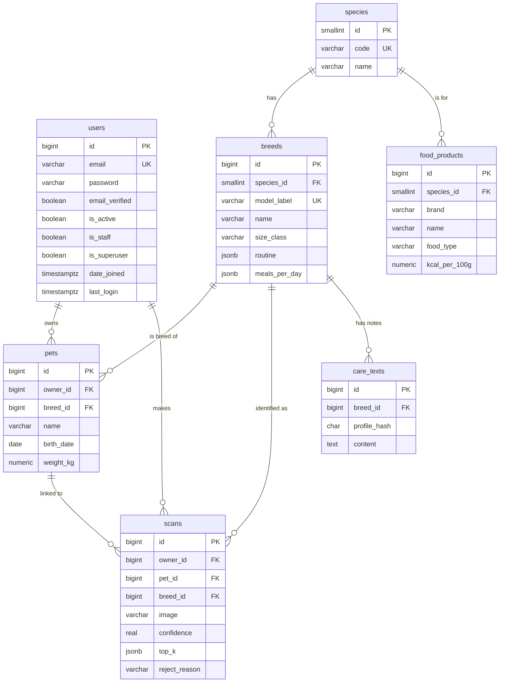

# Who's This Animal — Database Schema

PostgreSQL 17, managed by Django migrations. Every model sets `db_table` explicitly so the table names below match the code. Primary keys are `bigint` identity (`BigAutoField`) unless noted, and timestamps are `timestamptz`.

## ER diagram

The diagram shows only the key columns; the full columns are in the tables below.

## Tables

### `users` (Django `accounts.User`)

| Column | Type | Constraints | Notes |
|---|---|---|---|
| id | bigint | PK | |
| email | varchar(254) | NOT NULL, UNIQUE | Login. Always stored lowercased |
| password | varchar(128) | NOT NULL | Django PBKDF2 hash |
| email_verified | boolean | NOT NULL, default false | Login is refused until true |
| is_active | boolean | NOT NULL, default true | Reserved for disabling accounts |
| is_staff, is_superuser | boolean | NOT NULL, default false | Django admin |
| date_joined | timestamptz | NOT NULL, default now() | |
| last_login | timestamptz | NULL | |

Django's `PermissionsMixin` adds its own join tables (`users_groups`, `users_user_permissions`). They aren't listed here.

### `species`

| Column | Type | Constraints | Notes |
|---|---|---|---|
| id | smallint | PK | |
| code | varchar(10) | UNIQUE, CHECK in (`dog`,`cat`,`bird`) | |
| name | varchar(30) | NOT NULL | Shown in the UI |

### `breeds`
Holds the curated care data, one row per classifier class. Birds are stored at species level (PRD §4).

| Column | Type | Constraints | Notes |
|---|---|---|---|
| id | bigint | PK | |
| species_id | smallint | FK → species, ON DELETE RESTRICT | |
| model_label | varchar(80) | UNIQUE, NOT NULL | Matches the classifier label, e.g. `dog_golden_retriever` |
| name | varchar(100) | NOT NULL | e.g. "Golden Retriever" |
| origin | varchar(100) | | |
| size_class | varchar(10) | CHECK in (`toy`,`small`,`medium`,`large`,`giant`) | NULL for birds |
| adult_weight_min_kg | numeric(5,2) | CHECK > 0 | |
| adult_weight_max_kg | numeric(5,2) | CHECK ≥ min | |
| adult_age_months | smallint | NOT NULL, default 12 | 18–24 for large and giant dogs |
| life_expectancy_years | int4range | | e.g. `[10,13)` |
| temperament | text | | |
| exercise_min_per_day | smallint | | NULL for birds |
| grooming | text | | |
| health_notes | text | | Common issues + when to see a vet |
| foods_to_avoid | text[] | | |
| recommended_food_type | jsonb | | Per life stage, e.g. `{"puppy": "large-breed puppy dry", "adult": "..."}` |
| meals_per_day | jsonb | NOT NULL | e.g. `{"puppy": 3, "adult": 2, "senior": 2}` |
| routine | jsonb | NOT NULL | Per life stage: list of `{time, activity, duration_min, category}`; category is one of `meal`, `exercise`, `play`, `training`, `grooming`, `rest`, `cage` |
| daily_food_g_min | numeric(6,1) | | Birds only |
| daily_food_g_max | numeric(6,1) | | Birds only |
| reviewed | boolean | NOT NULL, default false | Set true after the human spot-check (IMPLEMENTATION §7.1) |

Per-species rule: birds need `daily_food_g_min` and `daily_food_g_max`; dogs and cats need both `adult_weight_*` columns. A Postgres CHECK can't read another table, so `Breed.clean()` enforces this, and the seed loader calls `full_clean()` on every row.

### `food_products`
Products sold in Algeria, written by hand (IMPLEMENTATION §7.1).

| Column | Type | Constraints | Notes |
|---|---|---|---|
| id | bigint | PK | |
| species_id | smallint | FK → species, ON DELETE RESTRICT | |
| brand | varchar(60) | NOT NULL | |
| name | varchar(120) | NOT NULL | |
| food_type | varchar(10) | CHECK in (`dry`,`wet`,`seed`,`pellet`) | |
| life_stage | varchar(10) | CHECK in (`young`,`adult`,`senior`,`all`) | |
| size_class | varchar(10) | NULL = any size | Same values as `breeds.size_class` |
| kcal_per_100g | numeric(6,1) | CHECK > 0 | From the packaging |
| where_to_find | text | | e.g. "Pet shops, most vet clinics" |
| price_dzd_approx | integer | NULL | Indicative price for a bag, in Algerian dinars |

Unique on (`brand`, `name`). Matching rule for a care sheet: same species, `life_stage` = the pet's stage or `all`, and `size_class` = the breed's size or NULL.

### `pets`

| Column | Type | Constraints | Notes |
|---|---|---|---|
| id | bigint | PK | |
| owner_id | bigint | FK → users, ON DELETE CASCADE | |
| breed_id | bigint | FK → breeds, ON DELETE SET NULL, NULL | |
| name | varchar(60) | NOT NULL | |
| birth_date | date | NOT NULL, CHECK ≤ current_date | "Approximate age" is converted to a date in the UI |
| sex | varchar(7) | CHECK in (`male`,`female`,`unknown`) | |
| neutered | boolean | NOT NULL, default false | |
| weight_kg | numeric(5,2) | NOT NULL, CHECK > 0 | |
| activity_level | varchar(6) | CHECK in (`low`,`normal`,`high`), default `normal` | |
| photo | varchar(255) | NULL | Copied from the scan image when the pet is created from a scan |
| created_at | timestamptz | NOT NULL, default now() | |
| updated_at | timestamptz | NOT NULL | |

Index: (`owner_id`, `name`).

### `scans`

| Column | Type | Constraints | Notes |
|---|---|---|---|
| id | bigint | PK | |
| owner_id | bigint | FK → users, ON DELETE CASCADE | |
| pet_id | bigint | FK → pets, ON DELETE SET NULL, NULL | Deleting a pet keeps its scans |
| image | varchar(255) | NOT NULL | Path under `MEDIA_ROOT/scans/<owner_id>/` |
| breed_id | bigint | FK → breeds, ON DELETE SET NULL, NULL | NULL means not recognized |
| confidence | real | CHECK between 0 and 1, NULL | Top-1 probability |
| top_k | jsonb | NOT NULL, default `[]` | `[{"label": "...", "confidence": 0.94}, ...]` |
| is_possible_mix | boolean | NOT NULL, default false | PRD S7 alternate flow |
| reject_reason | varchar(20) | NULL; CHECK in (`unreadable`,`too_small`,`blurry`,`too_dark`,`low_confidence`) | |
| model_version | varchar(60) | NULL | NULL when rejected before inference |
| created_at | timestamptz | NOT NULL, default now() | |

- Index: (`owner_id`, `created_at` DESC), for history.
- CHECK: `breed_id IS NULL OR reject_reason IS NULL`. A scan is either recognized or rejected, never both.
- The image file is deleted in the model's `delete()`; database cascades don't touch files.

### `care_texts`
Cache of the LLM personal notes (IMPLEMENTATION §7.3).

| Column | Type | Constraints | Notes |
|---|---|---|---|
| id | bigint | PK | |
| breed_id | bigint | FK → breeds, ON DELETE CASCADE | |
| profile_hash | char(64) | NOT NULL | sha256 of profile + `PROMPT_VERSION` |
| content | text | NOT NULL | |
| llm_model | varchar(60) | NOT NULL | e.g. `qwen3:8b` |
| created_at | timestamptz | NOT NULL, default now() | |

Unique on (`breed_id`, `profile_hash`). There's no FK to pets, so identical profiles share a row. When a pet is deleted its cached text stays behind; the hash includes the pet's name, so the content is only reused by an identical profile.

## Not stored

- **Nearby shops and vets:** fetched live from OSM in the browser (IMPLEMENTATION §8).
- **The owner's location:** never sent to the backend.
- **Sessions:** Django's default `django_session` table.

## Seed and migration order

1. `species`, created by a data migration (3 fixed rows)
2. `breeds` from `fixtures/breeds.json`, plus `food_products` from `fixtures/foods.json`
3. Every `breeds.model_label` must exist in the `labels` list in `model/artifacts/meta.json`, and vice versa. A management command, `check_labels`, fails if they differ.
