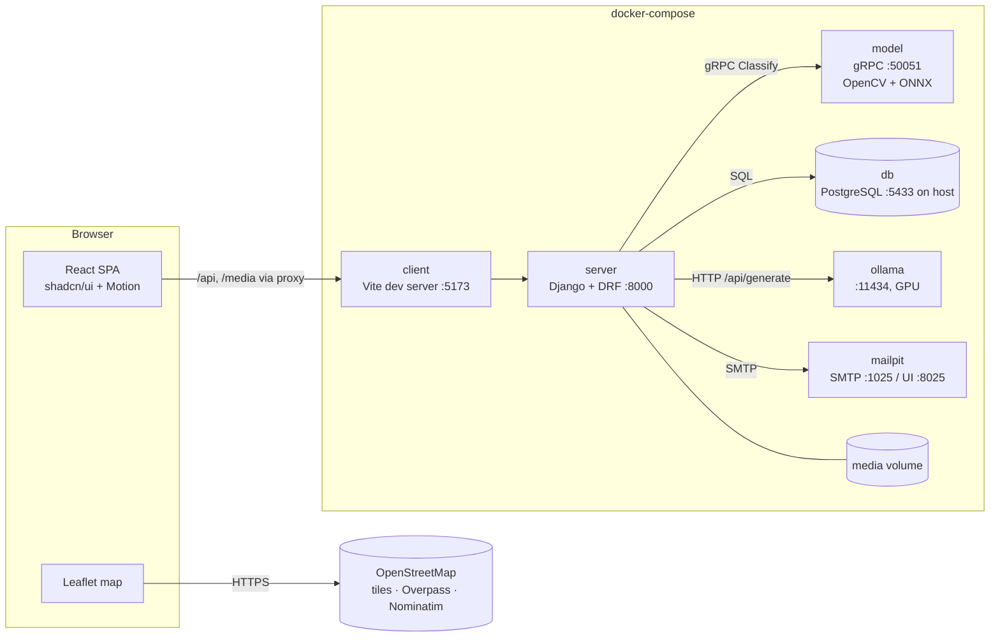
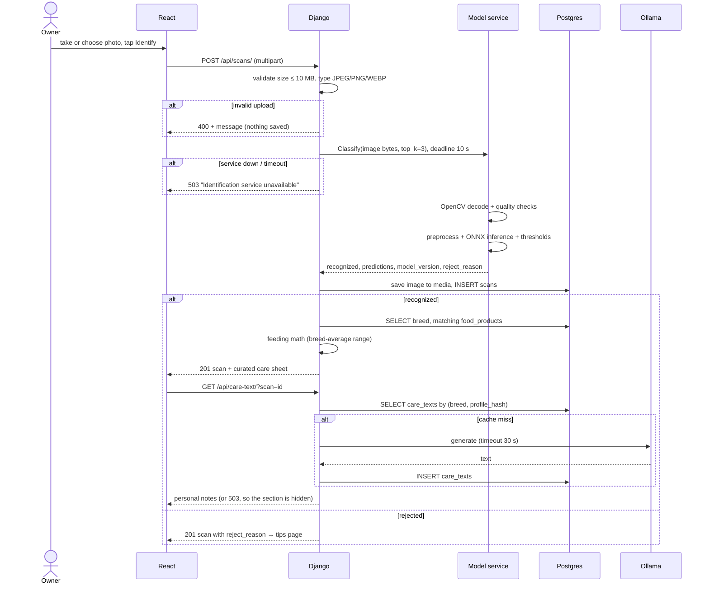
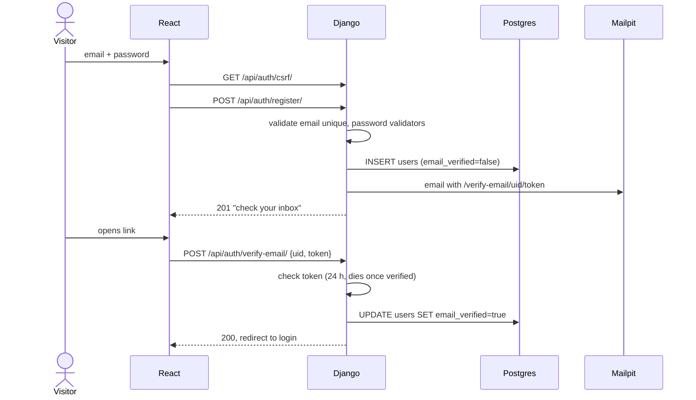
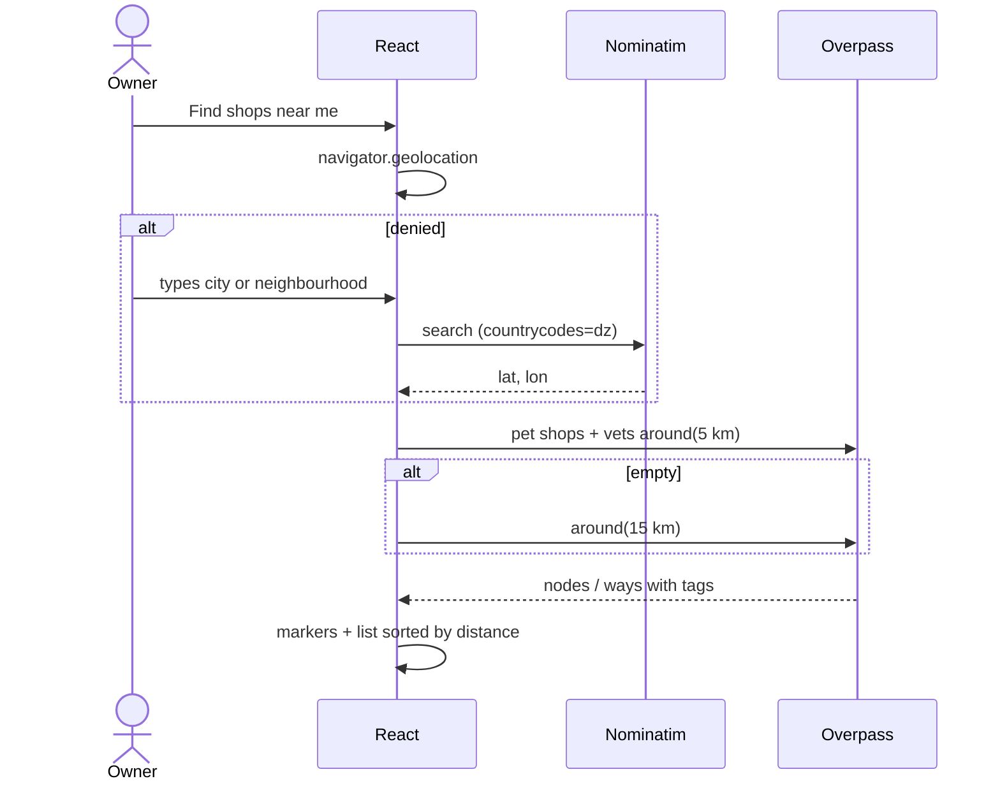

# Who's This Animal — System Design

Architecture and the main runtime flows. Tech choices are explained in [IMPLEMENTATION.md](IMPLEMENTATION.md) and the tables are defined in [DATABASE_SCHEMA.md](DATABASE_SCHEMA.md).

## 1. Components

| Component | Responsibility | Talks to |
|---|---|---|
| React SPA | Landing page, auth pages, workspace, care sheet, map | Django (REST via proxy), OSM (direct) |
| Django | Auth, owner data, scan orchestration, feeding math, LLM prompting, email | Postgres, model service, Ollama, Mailpit |
| Model service | Image quality checks + breed classification. Stateless; no database access | Nothing outbound |
| Postgres | Users, pets, scans, curated breed and food data, LLM text cache | — |
| Ollama | Personal notes at scan time; seed drafting (offline) | — |
| Mailpit | Catches verification and reset emails in development | — |

**The model service has no database access and doesn't know about users.** It takes bytes and returns labels, so it can be retrained and replaced without touching Django, as long as the labels in `meta.json` still match `breeds.model_label` (checked by `manage.py check_labels`).

## 2. Flow: photo scan

The pet detail page follows the same path, from `GET /api/pets/{id}/` to `GET /api/care-text/?pet=id`, using the pet's profile instead of breed averages.

## 3. Flow: signup and email verification

Password reset follows the same pattern, using `default_token_generator`: the token dies once the password changes.

## 4. Flow: nearby shops

Our backend is never involved in this flow, so the owner's location stays in the browser.

## 5. Deployment (local, docker-compose)

| Service | Image / build | Ports | Volumes | Depends on |
|---|---|---|---|---|
| db | `postgres:17` | 5433 → 5432 (a host Postgres already uses 5432) | `pgdata` | — |
| server | `docker/server.Dockerfile` | 8000 | `media`, `./server` (dev mount) | db, model, mailpit |
| model | `docker/model.Dockerfile` | 50051 | `./model/artifacts` (read-only) | — |
| client | `docker/client.Dockerfile` | 5173 | `./client` (dev mount) | server |
| ollama | `ollama/ollama` | 11434 | `ollama` (model weights) | — (GPU reserved via `deploy.resources.reservations.devices`) |
| mailpit | `axllent/mailpit` | 1025, 8025 | — | — |

Configuration lives in environment variables in `docker/.env`, which is git-ignored, with a committed `.env.example`. Examples: `DATABASE_URL`, `DJANGO_SECRET_KEY`, `MODEL_GRPC_ADDR`, `OLLAMA_URL`, `OLLAMA_MODEL`, `REJECT_THRESHOLD`, `SURE_THRESHOLD`, `BLUR_THRESHOLD`, `DARK_THRESHOLD`.

The GPU in Docker on Windows needs Docker Desktop with the WSL 2 backend and a current NVIDIA driver. Training runs on the host, not in Docker.

## 6. Failure handling

| Failure | Effect | User sees |
|---|---|---|
| Model service down or slow (> 10 s) | Scan isn't saved | "Identification service unavailable, try again" |
| Ollama down or slow (> 30 s) | Care sheet without personal notes | "Personal notes are unavailable right now" |
| OSM unreachable | Map page only | "Map service unavailable, try again later" |
| Mailpit / SMTP down | Account created, email not sent | "Resend email" button |
| Postgres down | API returns 500 | Generic error page |

## 7. Security basics

- **Owner scoping:** every queryset for pets, scans and care text is filtered by `request.user`. Requesting another owner's id returns 404, not 403, so ids aren't confirmed.
- **Uploads:** at most 10 MB, JPEG/PNG/WEBP only, checked by both content type and Pillow decoding. Files are stored under random UUID names, outside any executable path, and served only in development by Django; their URLs aren't guessable.
- **Auth:** session cookies (`HttpOnly`, `SameSite=Lax`), CSRF on every unsafe method, Django password validators. Login, register, resend-verification and password-reset are throttled with DRF `ScopedRateThrottle` (e.g. 10 per minute per IP).
- **Account enumeration:** the reset and resend-verification endpoints always return the same response.
- **LLM:** the prompt only contains curated fields and the pet profile. LLM output is rendered as plain text, never HTML.
- **Secrets:** `.env` is git-ignored; `DEBUG=False` outside development.
